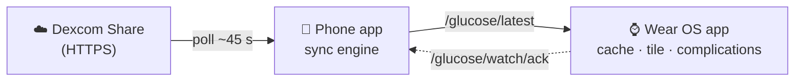

<div align="center">

# Glucose For Watch

**Your Dexcom glucose readings, at a glance on your Wear OS watch.**

An Android phone app that reads Dexcom Share and keeps a Wear OS companion in sync —
in the watch app, a tile, and watch-face complications.


<br>


[Features](#features) · [How it works](#how-it-works) · [Install](#install) · [Build from source](#build-from-source) · [Documentation](#documentation)

</div>

> [!WARNING]
> **Not a certified medical device.** Readings are for information only and must not be the sole basis for treatment decisions. Confirm them with an official Dexcom app and follow your healthcare provider's guidance. Read the full [medical disclaimer](docs/legal/medical-disclaimer.md).

## Features

| | |
|---|---|
| 📡 **Dexcom Share** | Reads glucose data for Dexcom **G6** and **G7** accounts |
| ⌚ **Phone → watch sync** | Sends each reading to the paired watch over the Wearable Data Layer |
| 🧩 **Watch surfaces** | Watch app, a tile, and short-text, long-text and ranged-value complications |
| 📏 **Units** | **mg/dL** or **mmol/L**, on the phone and the watch |
| 🔄 **Updates** | Automatic background updates, plus manual refresh from the phone or the watch tile |
| 🕒 **Freshness** | Sync status on the phone; cached watch readings are marked stale when they are no longer recent |

> [!NOTE]
> Glucose For Watch uses **Dexcom Share credentials**; it does not connect to a sensor over Bluetooth. Sharing must be enabled on the account. If Dexcom Share is down, fresh readings and phone-to-watch updates stop until the service recovers — see the [outage guidance](docs/guide/dexcom.md#dexcom-share-service-outages).

## How it works



More in the [architecture guide](docs/dev/architecture.md).

## Requirements

| To use the apps | To build from source |
|---|---|
| Android phone, **Android 9 (API 28)** or later | Android Studio with the Android SDK |
| Wear OS watch, **API 30** or later, paired with the phone | **Android SDK Platform 37** |
| Dexcom Share account with sharing enabled and follower credentials | **JDK 17+** (JBR 21 recommended in Android Studio) |
| Internet connection on the phone | |

## Install

The latest published release is **[v0.6.0](https://github.com/ToXY0392/Glucose-For-Watch/releases/tag/v0.6.0)**. Version 1.0.0 is not published yet.

1. Install the phone APK on your phone and the watch APK on your Wear OS watch.
2. Open the phone app and review the in-app legal notices.
3. Enter your Dexcom Share credentials and region, then start synchronization.
4. On the watch, add the **Glucose For Watch** tile or a supported complication.

> [!IMPORTANT]
> The app is **not distributed through Google Play**. Official APKs may be published in this repository for personal sideloading only.
> - They are signed with the Android **debug key**. Install an update only if it is signed with the same key as the installed app.
> - Uninstalling removes local app data: back up anything important first.
> - The debug signing key may change; future updates are not guaranteed to stay compatible.

## Build from source

**1. Point Gradle to your Android SDK** in a `local.properties` file at the repository root (never commit it):

```properties
sdk.dir=/path/to/Android/sdk
```

**2. Build both debug APKs:**

```bash
./gradlew :mobile:assembleDebug :wear:assembleDebug     # Windows: .\gradlew.bat …
```

| APK | Output |
|---|---|
| 📱 Phone | `mobile/build/outputs/apk/debug/mobile-debug.apk` |
| ⌚ Watch | `wear/build/outputs/apk/debug/wear-debug.apk` |

**3. Install** each APK on its device with Android Studio or ADB.

<details>
<summary>Install on phone and watch in one command</summary>
<br>

Add the device serials to `local.properties`:

```properties
gfw.adb.phone.serial=<phone_adb_serial>
gfw.adb.watch.serial=<watch_adb_serial>
```

Then run:

```bash
./gradlew installGlucoseForWatchDebug     # Windows: .\gradlew.bat installGlucoseForWatchDebug
```
</details>

More commands in the [developer setup guide](docs/dev/setup.md).

## Project structure

| Path | Purpose |
|------|---------|
| `mobile/` | Android phone app, Dexcom access and sync control |
| `wear/` | Wear OS companion app, tile and complications |
| `core/model/` | Shared glucose and sync models |
| `core/datalayer-contract/` | Phone-to-watch data contract |
| `feature/dexcom-share/` | Dexcom Share client |
| `feature/sync/` | Synchronization logic |
| `feature/watch-install/` | Debug watch installation support |
| `docs/` | User guides, technical documentation and policies |
| `scripts/` | Development and QA tools |

## Privacy and security

- 🔐 Dexcom Share credentials are stored **encrypted** on the phone.
- 💾 Glucose readings are cached locally on the phone and watch for sync and display.
- 🚫 Never commit credentials, `local.properties`, keystores, signing secrets or real glucose readings.
- 🙈 Keep credentials and identifiable health data out of issues, logs, screenshots and pull requests.

Details: [privacy policy](docs/legal/privacy-policy.md) · [security policy](SECURITY.md)

## Documentation

| Guide | |
|---|---|
| 👤 [User guide](docs/guide/user.md) | Setup and everyday use |
| 🩸 [Dexcom Share](docs/guide/dexcom.md) | G6 / G7 compatibility, requirements, outages |
| 🛠️ [Developer setup](docs/dev/setup.md) | Toolchain and build commands |
| 🧭 [Architecture](docs/dev/architecture.md) | Modules and synchronization flow |
| 📚 [Documentation index](docs/index.md) | Everything else |

## Contributing

Read [CONTRIBUTING.md](CONTRIBUTING.md) before opening a pull request. Changes are reviewed through pull requests and the repository's automated checks.

## License

The [license](LICENSE) allows downloading and installing official APKs published by the copyright holder in this repository, for **personal, non-commercial sideloading** on devices you own or control. It does not allow redistribution, modification, commercial use or app-store publication.
